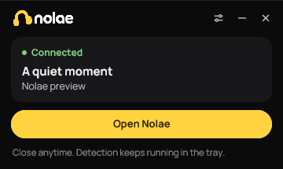

  

<h1 align="center">Nolae Companion</h1>

  Spotify playback detection for long streams and subathons.

  <a href="https://github.com/nolaedotapp/companion/releases/latest/download/nolae-companion-setup.exe"><strong>Download for Windows</strong></a>
   
  <a href="https://github.com/nolaedotapp/companion/tree/main">View source on GitHub</a>

  <strong>Windows 10 / 11 &middot; 64-bit &middot; Spotify desktop</strong>

Nolae Companion reads Spotify desktop on your PC to keep your overlay up to date with fewer Spotify playback checks.

  

## Get started

1. **Download and install** the Windows app.
2. **Pair your PC.** Open your [Nolae queue](https://nolae.app/queue), expand **Local playback detection**, and create a code. Copy it, then choose **Paste pairing code** in the app.
3. **Open Spotify desktop.** That's it. Turn on **Start with Windows** in Settings if you want it ready next time.

You can close the window and keep streaming. Its interface exits to free resources while playback detection stays in your tray. Reopen it whenever you need it. Choose **Quit Companion** from the tray menu to stop it.

<strong>A few things to know</strong>

**Who is it for?** Streamers planning long sessions, overnight streams or subathons. Set it up before going live.

**What does it read?** The song playing in Spotify desktop, its timing, and cover art. It doesn't record audio or ask for your Spotify password.

**Does it control my queue?** No. Queue controls stay in Nolae. Closing or quitting this app doesn't pause Spotify or your requests.

**Does it remove Spotify's limits?** No. Requests and playback controls can still be limited. [Read how Spotify quotas work.](https://docs.nolae.app/spotify-quota)

---

[Setup & help](https://docs.nolae.app/companion) · [Changelog](https://github.com/nolaedotapp/companion/releases) · [MIT license](LICENSE)
